# Seaborn visual styles

## Capture scope

This representative atlas preserves the 49 official Seaborn gallery examples available on the source page at capture time. It is not a comprehensive catalogue of every Seaborn result. Seaborn is narrower than Matplotlib by design, but its function families expose many switches for changing semantics, faceting, palettes, statistical treatment and layout.

## A visual vocabulary needs a data vocabulary

The word data covers several different jobs. A Python `dtype` tells you how a value is stored; it does not, by itself, tell you what that value means in a chart.

A measured amount can be placed on a numeric axis. A category names a group. An ordered category has a sequence without trustworthy numeric gaps. A date carries order and intervals. An identifier names a row or entity, but is not a measurement.

One purchase row might contain `price = 9.95` (measurement), `item = "gloves"` (category), `purchased = "Tuesday 12 March"` (time), and `transaction_id = 10482` (identifier). Keep three questions separate: how values are stored (`dtype`), what they mean in the investigation (their role), and how rows are arranged (one variable, two variables, groups, long form, wide form or a matrix).

The route is: variable roles -> data arrangement -> question -> plotting function -> switches. That is why a data vocabulary comes before a visual vocabulary.

Source page: https://seaborn.pydata.org/examples/index.html

The visual labels are made permanently visible here. Each entry keeps the official example title, function label, thumbnail, representative call and source link. The official page contains the complete example code.

## Plotting functions and switches

A plotting function is the precise Python term for the named callable, such as `sns.scatterplot()`. We can use plotting method as a friendly shorthand for the major display type. The function chooses the display; keyword parameters act as switches that control mappings, grouping, appearance, statistics and layout.

Basic call:

~~~python
sns.scatterplot(x="carat", y="price", data=diamonds)
~~~

Richer call from Example 02:

~~~python
sns.scatterplot(
    x="carat", y="price", data=diamonds,
    hue="clarity", size="depth",
    palette="ch:r=-.2,d=.3_r",
    hue_order=clarity_ranking,
    sizes=(1, 8), linewidth=0,
)
~~~

High-value switch groups: `x=` / `y=` / `data=` for mappings; `hue=` / `style=` / `size=` for semantics; `palette=` / `color=` / `alpha=` for appearance; `kind=` / `bins=` / `stat=` / `errorbar=` for statistical treatment; and `row=` / `col=` / `height=` / `aspect=` for layout. These are orientation maps rather than complete API parameter lists.

## seaborn.objects

The newer objects interface is signposted separately because it changes the way a plot is specified: Plot maps data, Mark draws, Stat transforms, Move adjusts positions, and Scale controls mappings.

## Relationships

Use these when the question concerns association, continuity or how one variable changes with another.

These displays are useful when two variables may be associated or when an ordered sequence shows change over time. They are less useful when the main information is simply that observations belong to named groups, with no meaningful relationship between two measured axes.

High-value starter switches for this family (not every keyword in the full API):

`kind=` — relplot can switch between scatter and line., `hue=` — Map a variable to colour so groups become visible., `style=` — Map a variable to marker or line style., `size=` — Map a variable to point size or line width., `row= / col=` — Facet the same relationship into small multiples., `col_wrap=` — Wrap many column facets onto multiple rows.

### 02. Scatterplot with multiple semantics

Seaborn function: sns.scatterplot()
Role: One point per observation; map more variables to visual semantics.

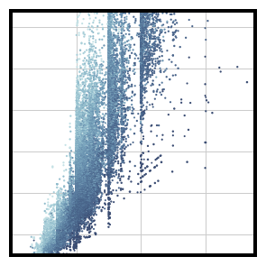

Representative call

~~~python
sns.scatterplot(x="carat", y="price",
                hue="clarity", size="depth",
                palette="ch:r=-.2,d=.3_r",
                hue_order=clarity_ranking,
                sizes=(1, 8), linewidth=0,
                data=diamonds, ax=ax)
~~~

Open the official example: https://seaborn.pydata.org/examples/different_scatter_variables.html

### 03. Timeseries plot with error bands

Seaborn function: sns.lineplot()
Role: Connect ordered observations; use grouping and error bands to show continuity.

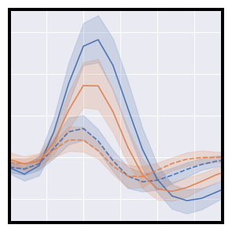

Representative call

~~~python
sns.lineplot(x="timepoint", y="signal",
             hue="region", style="event",
             data=fmri)
~~~

Open the official example: https://seaborn.pydata.org/examples/errorband_lineplots.html

### 05. Line plots on multiple facets

Seaborn function: sns.relplot()
Role: Figure-level relational interface: switch between relational kinds and facet them.

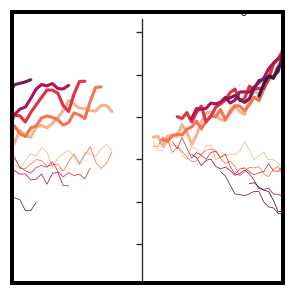

Representative call

~~~python
sns.relplot(
    data=dots,
    x="time", y="firing_rate",
    hue="coherence", size="choice", col="align",
    kind="line", size_order=["T1", "T2"], palette=palette,
    height=5, aspect=.75, facet_kws=dict(sharex=False),
)
~~~

Open the official example: https://seaborn.pydata.org/examples/faceted_lineplot.html

### 09. Scatterplot heatmap

Seaborn function: sns.relplot()
Role: Figure-level relational interface: switch between relational kinds and facet them.

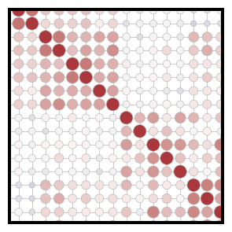

Representative call

~~~python
g = sns.relplot(
    data=corr_mat,
    x="level_0", y="level_1", hue="correlation", size="correlation",
    palette="vlag", hue_norm=(-1, 1), edgecolor=".7",
    height=10, sizes=(50, 250), size_norm=(-.2, .8),
)
~~~

Open the official example: https://seaborn.pydata.org/examples/heat_scatter.html

### 18. Bivariate plot with multiple elements

Seaborn function: sns.scatterplot()
Role: One point per observation; map more variables to visual semantics.

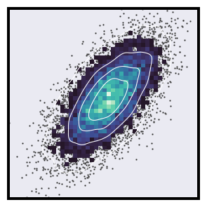

Representative call

~~~python
sns.scatterplot(x=x, y=y, s=5, color=".15")
~~~

Open the official example: https://seaborn.pydata.org/examples/layered_bivariate_plot.html

### 37. Scatterplot with varying point sizes and hues

Seaborn function: sns.relplot()
Role: Figure-level relational interface: switch between relational kinds and facet them.

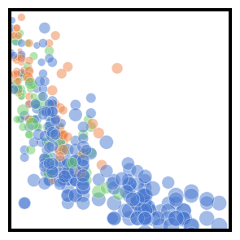

Representative call

~~~python
sns.relplot(x="horsepower", y="mpg", hue="origin", size="weight",
            sizes=(40, 400), alpha=.5, palette="muted",
            height=6, data=mpg)
~~~

Open the official example: https://seaborn.pydata.org/examples/scatter_bubbles.html

### 40. Scatterplot with continuous hues and sizes

Seaborn function: sns.relplot()
Role: Figure-level relational interface: switch between relational kinds and facet them.

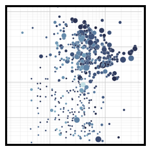

Representative call

~~~python
g = sns.relplot(
    data=planets,
    x="distance", y="orbital_period",
    hue="year", size="mass",
    palette=cmap, sizes=(10, 200),
)
~~~

Open the official example: https://seaborn.pydata.org/examples/scatterplot_sizes.html

### 47. Small multiple time series

Seaborn function: sns.relplot()
Role: Figure-level relational interface: switch between relational kinds and facet them.

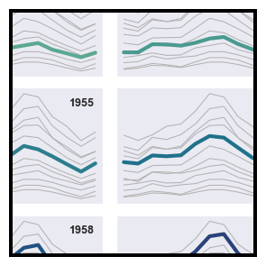

Representative call

~~~python
g = sns.relplot(
    data=flights,
    x="month", y="passengers", col="year", hue="year",
    kind="line", palette="crest", linewidth=4, zorder=5,
    col_wrap=3, height=2, aspect=1.5, legend=False,
)
~~~

Open the official example: https://seaborn.pydata.org/examples/timeseries_facets.html

### 48. Lineplot from a wide-form dataset

Seaborn function: sns.lineplot()
Role: Connect ordered observations; use grouping and error bands to show continuity.

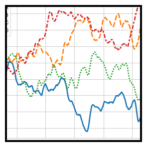

Representative call

~~~python
sns.lineplot(data=data, palette="tab10", linewidth=2.5)
~~~

Open the official example: https://seaborn.pydata.org/examples/wide_data_lineplot.html

## Distributions

Use these when the question concerns spread, density, frequency, cumulative position or shape.

These displays are useful when one measured variable is the subject and you want to see its spread, concentration, skew, unusual values or density—for example, delivery times. They are less useful when the main question is how one variable changes with another.

High-value starter switches for this family (not every keyword in the full API):

`kind=` — displot can switch among histogram, KDE, ECDF and rug views., `bins=` — Change the number or boundaries of histogram intervals., `stat=` — Choose counts, probability, density or percent-style summaries., `multiple=` — Layer, stack, fill or dodge distributions for comparison., `element=` — Use bars, steps or polygons for histogram construction., `common_norm=` — Decide whether group densities share a normalisation.

### 04. Facetting histograms by subsets of data

Seaborn function: sns.displot()
Role: Figure-level distribution interface: switch among histogram, KDE, ECDF and rug views.

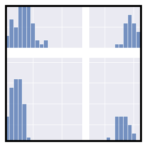

Representative call

~~~python
sns.displot(
    df, x="flipper_length_mm", col="species", row="sex",
    binwidth=3, height=3, facet_kws=dict(margin_titles=True),
)
~~~

Open the official example: https://seaborn.pydata.org/examples/faceted_histogram.html

### 11. Stacked histogram on a log scale

Seaborn function: sns.histplot()
Role: Count or normalise observations inside bins; compare groups with hue and elements.

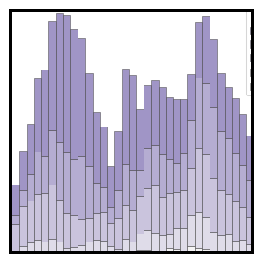

Representative call

~~~python
sns.histplot(
    diamonds,
    x="price", hue="cut",
    multiple="stack",
    palette="light:m_r",
    edgecolor=".3",
    linewidth=.5,
    log_scale=True,
)
~~~

Open the official example: https://seaborn.pydata.org/examples/histogram_stacked.html

### 17. Plotting large distributions

Seaborn function: sns.boxenplot()
Role: Show distribution summaries for larger datasets with more quantile detail.

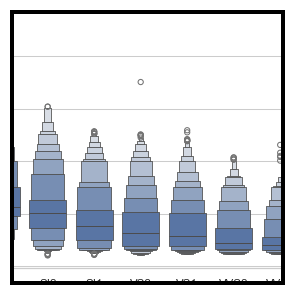

Representative call

~~~python
sns.boxenplot(
    diamonds, x="clarity", y="carat",
    color="b", order=clarity_ranking, width_method="linear",
)
~~~

Open the official example: https://seaborn.pydata.org/examples/large_distributions.html

### 23. Multiple bivariate KDE plots

Seaborn function: sns.kdeplot()
Role: Estimate a smooth density and compare distributions through hue or levels.

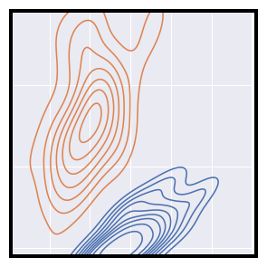

Representative call

~~~python
sns.kdeplot(
    data=iris.query("species != 'versicolor'"),
    x="sepal_width",
    y="sepal_length",
    hue="species",
    thresh=.1,
)
~~~

Open the official example: https://seaborn.pydata.org/examples/multiple_bivariate_kde.html

### 24. Conditional kernel density estimate

Seaborn function: sns.displot()
Role: Figure-level distribution interface: switch among histogram, KDE, ECDF and rug views.

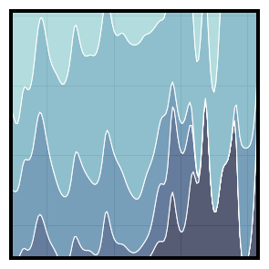

Representative call

~~~python
sns.displot(
    data=diamonds,
    x="carat", hue="cut",
    kind="kde", height=6,
    multiple="fill", clip=(0, None),
    palette="ch:rot=-.25,hue=1,light=.75",
)
~~~

Open the official example: https://seaborn.pydata.org/examples/multiple_conditional_kde.html

### 25. Facetted ECDF plots

Seaborn function: sns.displot()
Role: Figure-level distribution interface: switch among histogram, KDE, ECDF and rug views.

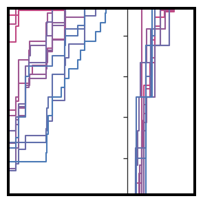

Representative call

~~~python
sns.displot(
    mpg,
    x="displacement", col="origin", hue="model_year",
    kind="ecdf", aspect=.75, linewidth=2, palette=cmap,
)
~~~

Open the official example: https://seaborn.pydata.org/examples/multiple_ecdf.html

### 31. Different cubehelix palettes

Seaborn function: sns.kdeplot()
Role: Estimate a smooth density and compare distributions through hue or levels.

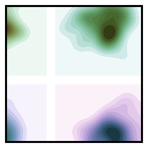

Representative call

~~~python
sns.kdeplot(
        x=x, y=y,
        cmap=cmap, fill=True,
        clip=(-5, 5), cut=10,
        thresh=0, levels=15,
        ax=ax,
    )
~~~

Open the official example: https://seaborn.pydata.org/examples/palette_generation.html

### 46. Trivariate histogram with two categorical variables

Seaborn function: sns.displot()
Role: Figure-level distribution interface: switch among histogram, KDE, ECDF and rug views.

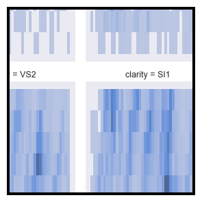

Representative call

~~~python
sns.displot(
    data=diamonds, x="price", y="color", col="clarity",
    log_scale=(True, False), col_wrap=4, height=4, aspect=.7,
)
~~~

Open the official example: https://seaborn.pydata.org/examples/three_variable_histogram.html

## Categorical comparisons

Use these when observations belong to named groups and the comparison is within or between categories.

These displays are useful when observations belong to named groups and you want to compare a measured outcome across those groups—for example, glove price by material or delivery time by weekday. They are less useful when the important structure is a relationship between two continuous measurements.

High-value starter switches for this family (not every keyword in the full API):

`kind=` — catplot can switch among strip, swarm, box, violin, boxen, point, bar and count., `order=` — Control the order in which categories appear., `hue=` — Add a second categorical grouping through colour., `dodge=` — Separate or overlap hue groups within each category., `inner=` — Choose the summary drawn inside a violin plot., `native_scale=` — Keep numeric or datetime category positions on their original scale.

### 06. Grouped barplots

Seaborn function: sns.catplot()
Role: Figure-level categorical interface with switchable plot kinds and facets.

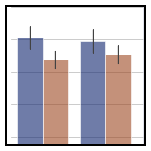

Representative call

~~~python
g = sns.catplot(
    data=penguins, kind="bar",
    x="species", y="body_mass_g", hue="sex",
    errorbar="sd", palette="dark", alpha=.6, height=6
)
~~~

Open the official example: https://seaborn.pydata.org/examples/grouped_barplot.html

### 07. Grouped boxplots

Seaborn function: sns.boxplot()
Role: Compare categorical distributions through quartiles and potential outliers.

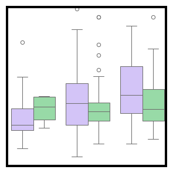

Representative call

~~~python
sns.boxplot(x="day", y="total_bill",
            hue="smoker", palette=["m", "g"],
            data=tips)
~~~

Open the official example: https://seaborn.pydata.org/examples/grouped_boxplot.html

### 08. Grouped violinplots with split violins

Seaborn function: sns.violinplot()
Role: Combine a distribution shape with categorical comparison and inner summaries.

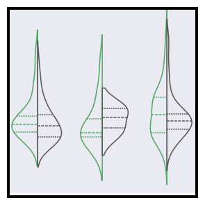

Representative call

~~~python
sns.violinplot(data=tips, x="day", y="total_bill", hue="smoker",
               split=True, inner="quart", fill=False,
               palette={"Yes": "g", "No": ".35"})
~~~

Open the official example: https://seaborn.pydata.org/examples/grouped_violinplots.html

### 12. Horizontal boxplot with observations

Seaborn function: sns.boxplot()
Role: Compare categorical distributions through quartiles and potential outliers.

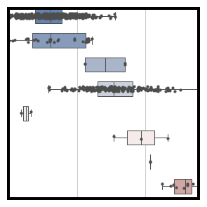

Representative call

~~~python
sns.boxplot(
    planets, x="distance", y="method", hue="method",
    whis=[0, 100], width=.6, palette="vlag"
)
~~~

Open the official example: https://seaborn.pydata.org/examples/horizontal_boxplot.html

### 13. Conditional means with observations

Seaborn function: sns.stripplot()
Role: Show individual observations across categories, with jitter for overlap.

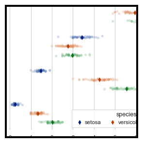

Representative call

~~~python
sns.stripplot(
    data=iris, x="value", y="measurement", hue="species",
    dodge=True, alpha=.25, zorder=1, legend=False,
)
~~~

Open the official example: https://seaborn.pydata.org/examples/jitter_stripplot.html

### 30. Color palette choices

Seaborn function: sns.barplot()
Role: Estimate a summary for each category and show uncertainty with error bars.

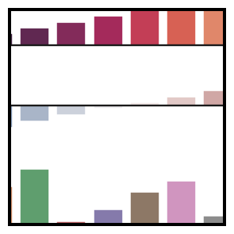

Representative call

~~~python
sns.barplot(x=x, y=y1, hue=x, palette="rocket", ax=ax1)
~~~

Open the official example: https://seaborn.pydata.org/examples/palette_choices.html

### 32. Horizontal bar plots

Seaborn function: sns.barplot()
Role: Estimate a summary for each category and show uncertainty with error bars.

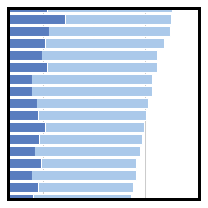

Representative call

~~~python
sns.barplot(x="total", y="abbrev", data=crashes,
            label="Total", color="b")
~~~

Open the official example: https://seaborn.pydata.org/examples/part_whole_bars.html

### 33. Plotting a three-way ANOVA

Seaborn function: sns.catplot()
Role: Figure-level categorical interface with switchable plot kinds and facets.

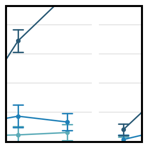

Representative call

~~~python
g = sns.catplot(
    data=exercise, x="time", y="pulse", hue="kind", col="diet",
    capsize=.2, palette="YlGnBu_d", errorbar="se",
    kind="point", height=6, aspect=.75,
)
~~~

Open the official example: https://seaborn.pydata.org/examples/pointplot_anova.html

### 38. Scatterplot with categorical variables

Seaborn function: sns.swarmplot()
Role: Show individual observations while arranging points to reduce overlap.

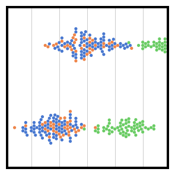

Representative call

~~~python
ax = sns.swarmplot(data=df, x="body_mass_g", y="sex", hue="species")
~~~

Open the official example: https://seaborn.pydata.org/examples/scatterplot_categorical.html

### 41. Horizontal, unfilled violinplots

Seaborn function: sns.violinplot()
Role: Combine a distribution shape with categorical comparison and inner summaries.

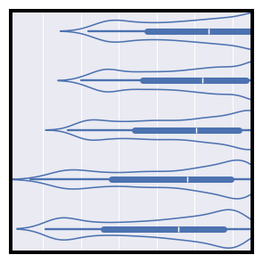

Representative call

~~~python
sns.violinplot(seaice, x="Extent", y="Decade", orient="y", fill=False)
~~~

Open the official example: https://seaborn.pydata.org/examples/simple_violinplots.html

### 44. Regression fit over a strip plot

Seaborn function: sns.catplot()
Role: Figure-level categorical interface with switchable plot kinds and facets.

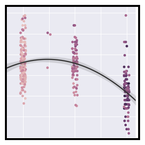

Representative call

~~~python
sns.catplot(
    data=mpg, x="cylinders", y="acceleration", hue="weight",
    native_scale=True, zorder=1
)
~~~

Open the official example: https://seaborn.pydata.org/examples/strip_regplot.html

### 49. Violinplot from a wide-form dataset

Seaborn function: sns.violinplot()
Role: Combine a distribution shape with categorical comparison and inner summaries.

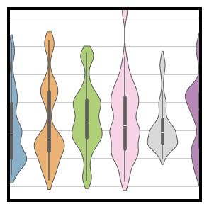

Representative call

~~~python
sns.violinplot(data=corr_df, bw_adjust=.5, cut=1, linewidth=1, palette="Set3")
~~~

Open the official example: https://seaborn.pydata.org/examples/wide_form_violinplot.html

## Regression

Use these when a fitted relationship or its residual pattern is part of the question.

These displays are useful when a fitted relationship can summarise the pattern between variables. A residual is the leftover difference between an observed value and the model’s estimate, so residual views help reveal what the fitted line has not explained. They are less useful as evidence of causation, or when there is no sensible relationship to model.

High-value starter switches for this family (not every keyword in the full API):

`order=` — Fit a polynomial regression of the chosen order., `hue= / col=` — Fit and compare models across groups or facets., `logistic=` — Fit a logistic rather than ordinary linear model., `robust=` — Use a robust fit when outliers may dominate the ordinary fit., `lowess=` — Use a locally weighted smooth rather than a parametric model., `errorbar=` — Control the uncertainty band around an estimate or fit.

### 01. Anscombe’s quartet

Seaborn function: sns.lmplot()
Role: Fit a regression model while retaining observations and faceting options.

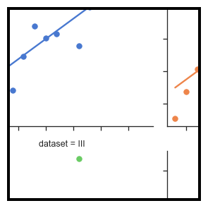

Representative call

~~~python
sns.lmplot(
    data=df, x="x", y="y", col="dataset", hue="dataset",
    col_wrap=2, palette="muted", ci=None,
    height=4, scatter_kws={"s": 50, "alpha": 1}
)
~~~

Open the official example: https://seaborn.pydata.org/examples/anscombes_quartet.html

### 19. Faceted logistic regression

Seaborn function: sns.lmplot()
Role: Fit a regression model while retaining observations and faceting options.

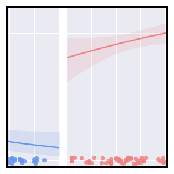

Representative call

~~~python
g = sns.lmplot(x="age", y="survived", col="sex", hue="sex", data=df,
               palette=pal, y_jitter=.02, logistic=True, truncate=False)
~~~

Open the official example: https://seaborn.pydata.org/examples/logistic_regression.html

### 26. Multiple linear regression

Seaborn function: sns.lmplot()
Role: Fit a regression model while retaining observations and faceting options.

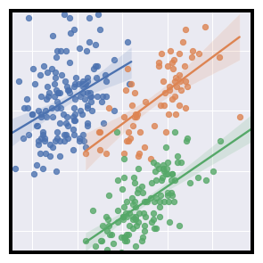

Representative call

~~~python
g = sns.lmplot(
    data=penguins,
    x="bill_length_mm", y="bill_depth_mm", hue="species",
    height=5
)
~~~

Open the official example: https://seaborn.pydata.org/examples/multiple_regression.html

### 36. Plotting model residuals

Seaborn function: sns.residplot()
Role: Inspect the pattern left around a fitted relationship.

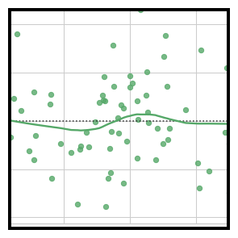

Representative call

~~~python
sns.residplot(x=x, y=y, lowess=True, color="g")
~~~

Open the official example: https://seaborn.pydata.org/examples/residplot.html

## Matrices

Use these when values form a rectangular matrix or pairwise structure is best read through colour.

These displays are useful when values already form a meaningful grid, such as correlations between many numeric variables, and colour or clustering can reveal structure. They are less useful for following individual observations row by row.

High-value starter switches for this family (not every keyword in the full API):

`cmap=` — Choose the colour mapping used to encode matrix values., `center=` — Set the meaningful midpoint for a diverging scale., `annot=` — Write values into heatmap cells when numbers matter., `mask=` — Hide cells that should not be displayed., `row_colors= / col_colors=` — Add side colour annotations for groups or metadata., `standard_scale=` — Scale rows or columns before comparison or clustering.

### 21. Plotting a diagonal correlation matrix

Seaborn function: sns.heatmap()
Role: Encode a rectangular matrix as colour, with annotation and masking controls.

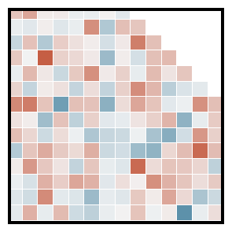

Representative call

~~~python
sns.heatmap(corr, mask=mask, cmap=cmap, vmax=.3, center=0,
            square=True, linewidths=.5, cbar_kws={"shrink": .5})
~~~

Open the official example: https://seaborn.pydata.org/examples/many_pairwise_correlations.html

### 43. Annotated heatmaps

Seaborn function: sns.heatmap()
Role: Encode a rectangular matrix as colour, with annotation and masking controls.

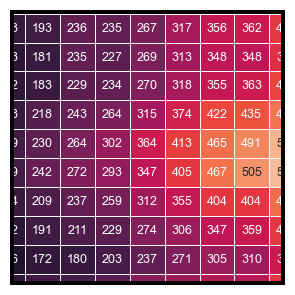

Representative call

~~~python
sns.heatmap(flights, annot=True, fmt="d", linewidths=.5, ax=ax)
~~~

Open the official example: https://seaborn.pydata.org/examples/spreadsheet_heatmap.html

### 45. Discovering structure in heatmap data

Seaborn function: sns.clustermap()
Role: Combine a heatmap with hierarchical clustering and colour annotations.

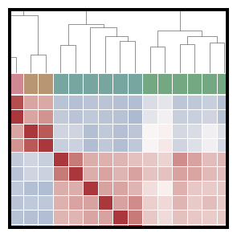

Representative call

~~~python
g = sns.clustermap(df.corr(), center=0, cmap="vlag",
                   row_colors=network_colors, col_colors=network_colors,
                   dendrogram_ratio=(.1, .2),
                   cbar_pos=(.02, .32, .03, .2),
                   linewidths=.75, figsize=(12, 13))
~~~

Open the official example: https://seaborn.pydata.org/examples/structured_heatmap.html

## Grids and composition

Use these when related subsets, pairs or marginal views need to be arranged together.

These displays are useful when the same question needs to be repeated across groups, variables or marginal views, making small multiples or pairwise comparisons easier to scan. They are less useful when many panels would make the overall pattern harder to read.

High-value starter switches for this family (not every keyword in the full API):

`row= / col=` — Create small multiples from subsets of the data., `map() / map_dataframe()` — Place an axes-level function into each facet., `kind=` — Convenience functions switch their inner bivariate view., `diag_kind= / corner=` — Change diagonal plots or reduce a pairwise matrix., `seaborn.objects` — Use a declarative Plot specification., `Mark + Stat + Move` — Compose visible marks, transformations and adjustments.

### 10. Hexbin plot with marginal distributions

Seaborn function: sns.jointplot()
Role: Convenient joint-and-marginal view with a switchable bivariate kind.

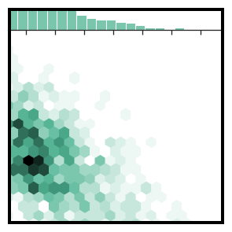

Representative call

~~~python
sns.jointplot(x=x, y=y, kind="hex", color="#4CB391")
~~~

Open the official example: https://seaborn.pydata.org/examples/hexbin_marginals.html

### 14. Joint and marginal histograms

Seaborn function: sns.JointGrid()
Role: Combine a bivariate view with marginal views on the same figure.

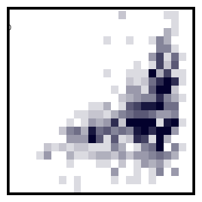

Representative call

~~~python
g = sns.JointGrid(data=planets, x="year", y="distance", marginal_ticks=True)
~~~

Open the official example: https://seaborn.pydata.org/examples/joint_histogram.html

### 15. Joint kernel density estimate

Seaborn function: sns.jointplot()
Role: Convenient joint-and-marginal view with a switchable bivariate kind.

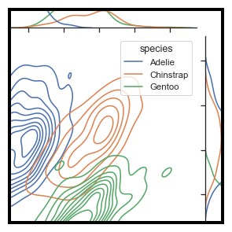

Representative call

~~~python
g = sns.jointplot(
    data=penguins,
    x="bill_length_mm", y="bill_depth_mm", hue="species",
    kind="kde",
)
~~~

Open the official example: https://seaborn.pydata.org/examples/joint_kde.html

### 16. Overlapping densities (‘ridge plot’)

Seaborn function: sns.FacetGrid()
Role: Build a grid of subsets and map a plotting function into each facet.

Representative call

~~~python
g = sns.FacetGrid(df, row="g", hue="g", aspect=15, height=.5, palette=pal)
~~~

Open the official example: https://seaborn.pydata.org/examples/kde_ridgeplot.html

### 20. Plotting on a large number of facets

Seaborn function: sns.FacetGrid()
Role: Build a grid of subsets and map a plotting function into each facet.

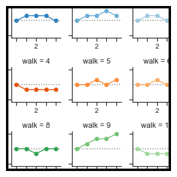

Representative call

~~~python
grid = sns.FacetGrid(df, col="walk", hue="walk", palette="tab20c",
                     col_wrap=4, height=1.5)
~~~

Open the official example: https://seaborn.pydata.org/examples/many_facets.html

### 22. Scatterplot with marginal ticks

Seaborn function: sns.JointGrid()
Role: Combine a bivariate view with marginal views on the same figure.

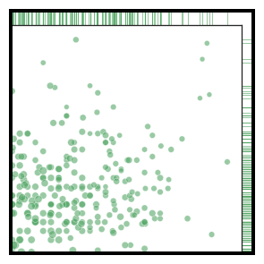

Representative call

~~~python
g = sns.JointGrid(data=mpg, x="mpg", y="acceleration", space=0, ratio=17)
~~~

Open the official example: https://seaborn.pydata.org/examples/marginal_ticks.html

### 27. Paired density and scatterplot matrix

Seaborn function: sns.PairGrid()
Role: Compose different plots on diagonal and off-diagonal pairwise views.

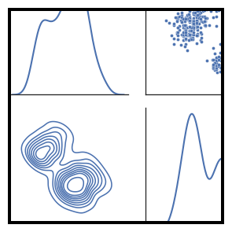

Representative call

~~~python
g = sns.PairGrid(df, diag_sharey=False)
~~~

Open the official example: https://seaborn.pydata.org/examples/pair_grid_with_kde.html

### 28. Paired categorical plots

Seaborn function: sns.PairGrid()
Role: Compose different plots on diagonal and off-diagonal pairwise views.

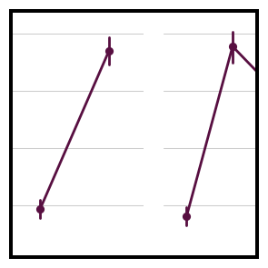

Representative call

~~~python
g = sns.PairGrid(titanic, y_vars="survived",
                 x_vars=["class", "sex", "who", "alone"],
                 height=5, aspect=.5)
~~~

Open the official example: https://seaborn.pydata.org/examples/paired_pointplots.html

### 29. Dot plot with several variables

Seaborn function: sns.PairGrid()
Role: Compose different plots on diagonal and off-diagonal pairwise views.

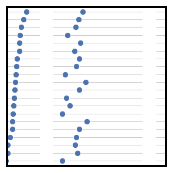

Representative call

~~~python
g = sns.PairGrid(crashes.sort_values("total", ascending=False),
                 x_vars=crashes.columns[:-3], y_vars=["abbrev"],
                 height=10, aspect=.25)
~~~

Open the official example: https://seaborn.pydata.org/examples/pairgrid_dotplot.html

### 34. FacetGrid with custom projection

Seaborn function: sns.FacetGrid()
Role: Build a grid of subsets and map a plotting function into each facet.

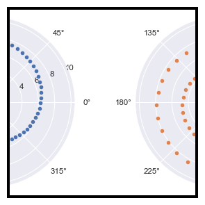

Representative call

~~~python
g = sns.FacetGrid(df, col="speed", hue="speed",
                  subplot_kws=dict(projection='polar'), height=4.5,
                  sharex=False, sharey=False, despine=False)
~~~

Open the official example: https://seaborn.pydata.org/examples/radial_facets.html

### 35. Linear regression with marginal distributions

Seaborn function: sns.jointplot()
Role: Convenient joint-and-marginal view with a switchable bivariate kind.

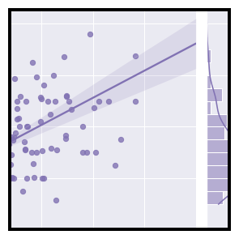

Representative call

~~~python
g = sns.jointplot(x="total_bill", y="tip", data=tips,
                  kind="reg", truncate=False,
                  xlim=(0, 60), ylim=(0, 12),
                  color="m", height=7)
~~~

Open the official example: https://seaborn.pydata.org/examples/regression_marginals.html

### 39. Scatterplot Matrix

Seaborn function: sns.pairplot()
Role: Convenient pairwise relationship matrix using common Seaborn defaults.

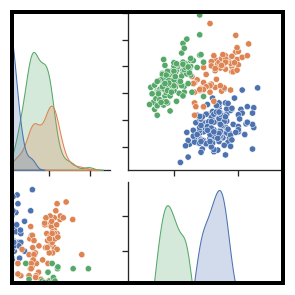

Representative call

~~~python
sns.pairplot(df, hue="species")
~~~

Open the official example: https://seaborn.pydata.org/examples/scatterplot_matrix.html

### 42. Smooth kernel density with marginal histograms

Seaborn function: sns.JointGrid()
Role: Combine a bivariate view with marginal views on the same figure.

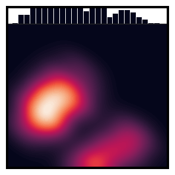

Representative call

~~~python
g = sns.JointGrid(data=df, x="body_mass_g", y="bill_depth_mm", space=0)
~~~

Open the official example: https://seaborn.pydata.org/examples/smooth_bivariate_kde.html
